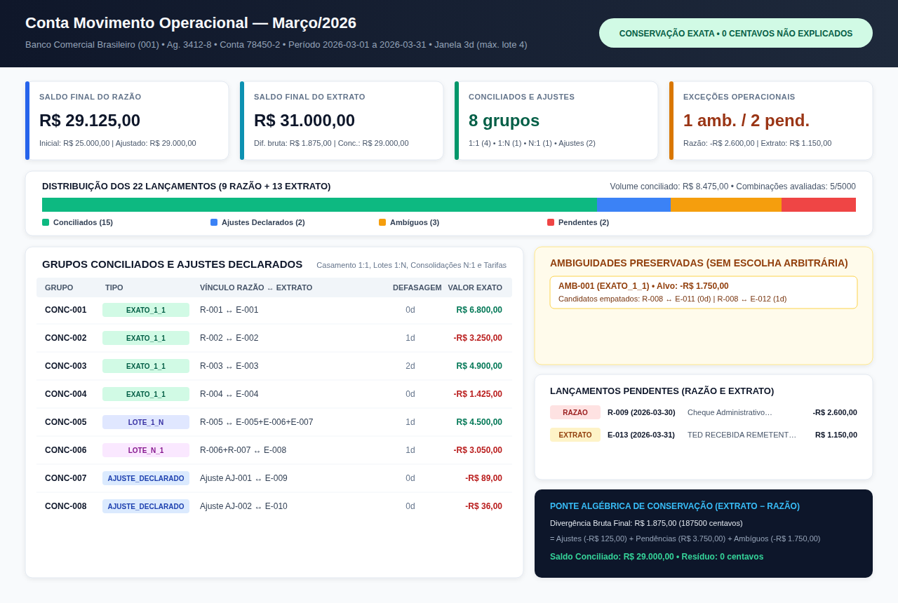

# Conciliação Bancária (`conciliacao-bancaria`)

Concilie razão contábil interno e extrato bancário em **centavos inteiros exatos** (`int`), sem ponto flutuante, com suporte a casamentos **1:1**, agrupamentos **1:N** (lote de títulos liquidados), consolidações **N:1** (borderô/remessa de pagamento), **ajustes declarados pelo operador** (tarifas, IOF, encargos), **preservação explícita de ambiguidades** (sem escolha silenciosa entre candidatos de mesma soma) e **quadro algébrico de conservação de saldos**.



---

## Principais Recursos

- **Aritmética 100% inteira em centavos**: o leitor JSON (`jsoncodec`) rejeita `float`, `NaN`, `Infinity`, BOM UTF-8 e chaves duplicadas na entrada e na saída.
- **Pipeline determinístico em 5 estágios**:
  1. **Ajustes declarados (`AJUSTE_DECLARADO`)**: tarifas, IOF, juros ou encargos explicitamente vinculados pelo operador a uma conta contábil e justificativa.
  2. **Casamento exato 1:1 (`EXATO_1_1`)**: pares mutuamente únicos com mesmo valor em centavos dentro de `janela_dias`.
  3. **Agrupamento limitado de subconjuntos (`LOTE_1_N` e `LOTE_N_1`)**: busca determinística de 1 lançamento do razão para $2 \dots k$ do extrato (ou $2 \dots k$ do razão para 1 do extrato), respeitando `janela_dias`, `max_agrupamento` e `orcamento_combinacoes`.
  4. **Preservação explícita de ambiguidades (`AMBIGUO`)**: quando múltiplos candidatos 1:1 ou múltiplos subconjuntos de mesma soma disputam o mesmo lançamento, todos os candidatos são reportados sem escolha arbitrária.
  5. **Pendências e conservação de saldos (`PENDENTE_RAZAO`, `PENDENTE_EXTRATO`, `quadro_saldos`)**: decomposição exata da divergência bruta entre saldo final do extrato e saldo final do razão com `diferenca_nao_explicada_centavos == 0`.
- **Pacote ZIP auditável e atômico**: exporta `entrada.json`, `resultado.json`, `conciliados.csv`, `pendencias.csv`, `lancamentos.csv`, `RELATORIO.md`, `painel-conciliacao.svg` e manifesto `SHA256SUMS`, com proteção contra *CSV Formula Injection* e publicação sem sobrescrita via arquivo temporário irmão + `os.link`.
- **Zero dependências de execução**: utiliza exclusivamente a biblioteca padrão do Python 3.11+.

---

## Instalação Local

```bash
python3 -m pip install .
```

Para desenvolvimento ou execução direta a partir do código-fonte:

```bash
PYTHONPATH=src python3 -m conciliacao_bancaria --version
```

---

## Uso Rápido via CLI

### 1. Gerar o pacote completo do cenário sintético oficial

```bash
conciliacao-bancaria exemplo --saida exemplo-conciliacao.zip
```

Ou exportar apenas o arquivo JSON de entrada do cenário sintético:

```bash
conciliacao-bancaria exemplo --saida entrada-exemplo.json
```

### 2. Conciliar um arquivo JSON de entrada

```bash
conciliacao-bancaria conciliar entrada-exemplo.json --saida pacote-conciliacao.zip
```

Você também pode ajustar os parâmetros diretamente na linha de comando:

```bash
conciliacao-bancaria conciliar entrada-exemplo.json \
  --saida resultado-customizado.zip \
  --janela-dias 5 \
  --max-agrupamento 4 \
  --orcamento-combinacoes 8000
```

### 3. Verificar a integridade criptográfica (`SHA256SUMS`) de um pacote ZIP

```bash
conciliacao-bancaria verificar pacote-conciliacao.zip
```

---

## Uso via API Python

```python
from conciliacao_bancaria import (
    load_example_data,
    reconcile,
    write_bundle_zip,
    verify_bundle_zip,
)

documento = load_example_data()
resultado = reconcile(documento)

print("Grupos conciliados:", resultado.resumo.total_grupos_conciliados)
print("Ambiguidades preservadas:", resultado.resumo.total_grupos_ambiguos)
print("Saldo razão ajustado (centavos):", resultado.quadro_saldos.saldo_razao_ajustado_centavos)
print("Conservação exata:", resultado.quadro_saldos.conservacao_exata)

write_bundle_zip(resultado, "meu-pacote.zip")
hashes = verify_bundle_zip("meu-pacote.zip")
```

---

## Cenário Sintético Empacotado (`data/exemplo.json`)

O arquivo `src/conciliacao_bancaria/data/exemplo.json` demonstra todos os casos operacionais de uma conciliação mensal empresarial (`CONTA-BB-OPERACIONAL-01`, período `2026-03-01` a `2026-03-31`):

| Caso Operacional | Lançamentos Razão | Lançamentos Extrato | Valor | Resultado Esperado |
| :--- | :--- | :--- | ---: | :--- |
| **4× Casamento 1:1** | `R-001`..`R-004` | `E-001`..`E-004` | `+R$ 6.800,00` a `-R$ 3.250,00` | `CONC-001`..`CONC-004` (`EXATO_1_1`, 0d a 2d) |
| **Lote 1:3 (Borderô)** | `R-005` (`+450000`) | `E-005` (`+180000`), `E-006` (`+150000`), `E-007` (`+120000`) | `R$ 4.500,00` | `CONC-005` (`LOTE_1_N`) |
| **Consolidação 2:1** | `R-006` (`-210000`), `R-007` (`-95000`) | `E-008` (`-305000`) | `-R$ 3.050,00` | `CONC-006` (`LOTE_N_1`) |
| **2× Tarifas Declaradas** | — (`AJ-001`, `AJ-002`) | `E-009` (`-8900`), `E-010` (`-3600`) | `-R$ 125,00` | `CONC-007`, `CONC-008` (`AJUSTE_DECLARADO`) |
| **1× Ambiguidade Intencional** | `R-008` (`-175000`) | `E-011` (`-175000`), `E-012` (`-175000`) | `-R$ 1.750,00` | `AMB-001` (`AMBIGUO`, 2 candidatos preservados) |
| **2× Pendências** | `R-009` (`-260000`) | `E-013` (`+115000`) | `-R$ 2.600,00` / `R$ 1.150,00` | `PENDENTE_RAZAO` e `PENDENTE_EXTRATO` |

---

## Documentação Adicional

- [Especificação do Formato JSON e CSV (`docs/FORMATO.md`)](docs/FORMATO.md)
- [Referência da API Python e CLI (`docs/API.md`)](docs/API.md)
- [Guia de Verificação Independente e Empacotamento (`docs/VERIFICACAO.md`)](docs/VERIFICACAO.md)
- [Interoperabilidade com SQLite, Planilhas e ERPs (`docs/INTEROPERABILIDADE.md`)](docs/INTEROPERABILIDADE.md)

---

## Verificação e Testes

```bash
python3 -m unittest discover -s tests -v
python3 tools/verify_independent.py
python3 -m build
python3 scripts/check_distribution.py --dist dist
```

---

## Licença e Autoria

Distribuído sob a licença **MIT**. Veja [`LICENSE`](LICENSE).

Desenvolvido por **Martin Lofrano / LOFRANO TECNOLOGIA** — [https://lofranotecnologia.com.br/](https://lofranotecnologia.com.br/).
